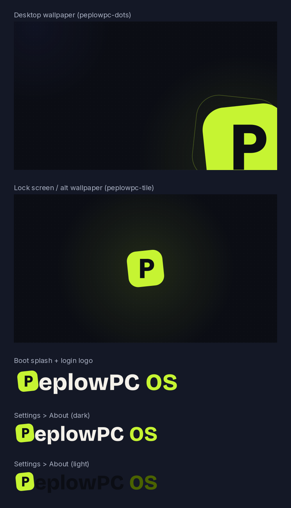

# PeplowPC OS

A security and privacy first Linux desktop from PeplowPC.
Tech help in plain English, now with a computer that protects people by default.

Working name: **PeplowPC OS** (see `docs/DECISIONS.md`).



## What it is

PeplowPC OS is Fedora Silverblue with three layers on top:

1. **Fedora Atomic base** (upstream, `quay.io/fedora-ostree-desktops/silverblue:45`): GNOME desktop, SELinux enforcing, Secure Boot with Fedora's signed kernel, an operating system that cannot be modified while running.
2. **PeplowPC hardening and privacy** (`system_files/`, `build_files/build.sh`): kernel and network hardening, encrypted DNS through Quad9, authenticated time, a closed firewall, telemetry off, signed automatic updates.
3. **PeplowPC look and defaults** (`branding/`, GNOME settings): ink and lime theme, PeplowPC wallpaper, boot splash and login screen, a short list of trusted starter apps.

We do not build a Linux distribution from scratch. Fedora maintains thousands of packages and ships security fixes daily; we only own the PeplowPC layer, the same approach as PeplowPC Browser on ungoogled-chromium.

## Design principles

- **Safe by default.** The person who never opens Settings gets the strongest protection that does not break normal use: printers, video calls, hotel Wi-Fi.
- **Updates happen by themselves, and can be undone.** The whole system updates as one signed image. If an update misbehaves, the previous version is one restart away.
- **Nothing phones home.** No telemetry, no crash uploads, no usage counting. Every remaining outbound connection is listed in `docs/SECURITY-BASELINE.md` and checked with `tools/audit-network.sh`.
- **Only trusted software.** The system only accepts updates signed with the PeplowPC key. Apps come from Flathub, limited to verified publishers.
- **Explain, do not lecture.** Every protection gets a plain-English reason in the docs, and later in the welcome app.

## Repository layout

| Path | Purpose |
|---|---|
| `Containerfile` | The image recipe: Fedora Silverblue plus the PeplowPC layer |
| `build_files/build.sh` | Everything that runs during the image build |
| `system_files/` | Files copied into the image as-is (hardening, services, branding) |
| `disk_config/iso.toml` | Installer settings |
| `.github/workflows/` | Daily signed image build; installer ISO build on demand |
| `branding/` | Brand tokens, asset generator, preview |
| `tools/` | Local build and network audit scripts |
| `keys/` | Public signing key `cosign.pub` (never the private key) |
| `docs/ROADMAP.md` | Phases and milestones |
| `docs/ARCHITECTURE.md` | How the layers, updates and signing fit together |
| `docs/SECURITY-BASELINE.md` | Every default we change, and why |
| `docs/DECISIONS.md` | Open decisions that need an owner call |
| `docs/BUILD.md` | One-time setup, building, testing in Hyper-V |

## Quick start

1. One-time setup (GitHub repo, signing key in `keys/`): `docs/BUILD.md`, "One-time setup".
2. Push to `main`. GitHub Actions builds, signs and publishes `ghcr.io/danvillian/peplowpc-os:stable`.
3. Run the **Build PeplowPC OS installer (ISO)** workflow and download the ISO.
4. Install in a Hyper-V VM: `docs/BUILD.md`, "Test in Hyper-V".

Already running Fedora Silverblue? Switch an existing machine to PeplowPC OS:

```bash
sudo rpm-ostree rebase ostree-unverified-registry:ghcr.io/danvillian/peplowpc-os:stable
systemctl reboot
```

On first boot after the switch, PeplowPC OS turns on signature checking for all future updates by itself.

## License

Our own code and docs: to be decided (see `docs/DECISIONS.md`). Fedora packages keep their own licenses.

PeplowPC OS is based on Fedora. It is not affiliated with or endorsed by the Fedora Project or Red Hat.
